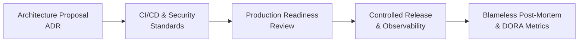

# DevOps Engineering Playbook

[](https://github.com/papilias/devops-engineering-playbook/actions/workflows/markdown-lint.yml)

Standardized operational frameworks, governance templates, and engineering practices for scaling DevOps across multi-team enterprise, fintech, and high-availability environments.

## Delivery Governance Lifecycle



## Repository Structure

```text
.
├── templates/
│   ├── adr-template.md                   # Architecture Decision Record (ADR) template
│   ├── production-readiness-checklist.md # Go-live gate for new services & infrastructure
│   └── incident-postmortem.md            # Blameless root-cause analysis (RCA) template
└── .github/
    └── workflows/
        └── markdown-lint.yml             # Automated Markdown linting on every push/PR
```

## Core Principles
- **Paved Roads Over Gatekeeping:** Provide teams with self-service, compliant golden paths (CI/CD templates, hardened base images, IaC modules) so doing the secure thing is also the fastest path to production.
- **Documented Trade-Offs (ADRs):** Major infrastructure and platform changes are captured as lightweight Architecture Decision Records—preserving the *why* behind decisions as teams scale.
- **Blameless Reliability Culture:** Production incidents are treated as systemic signals rather than individual failures, driving concrete action items tied to SLIs/SLOs and DORA metrics.
